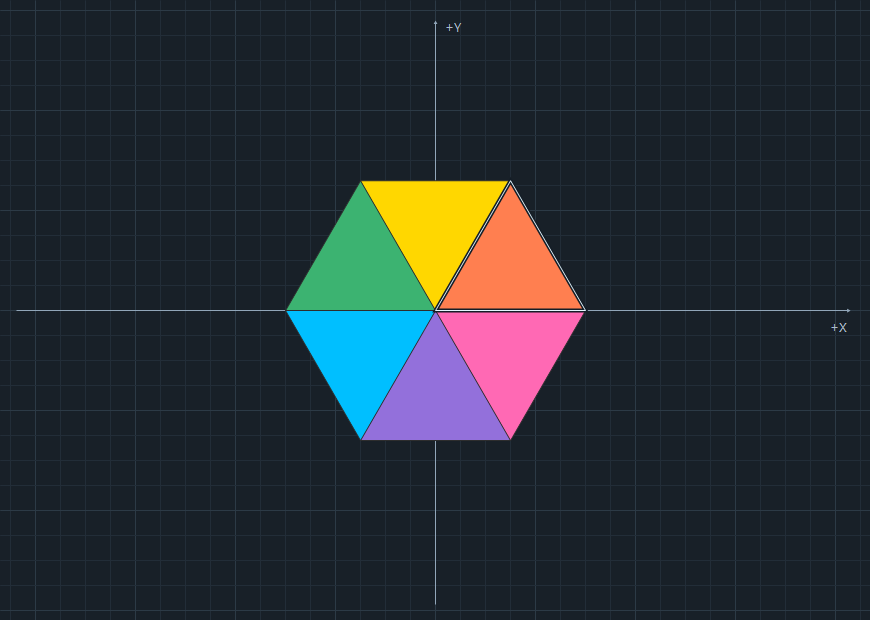
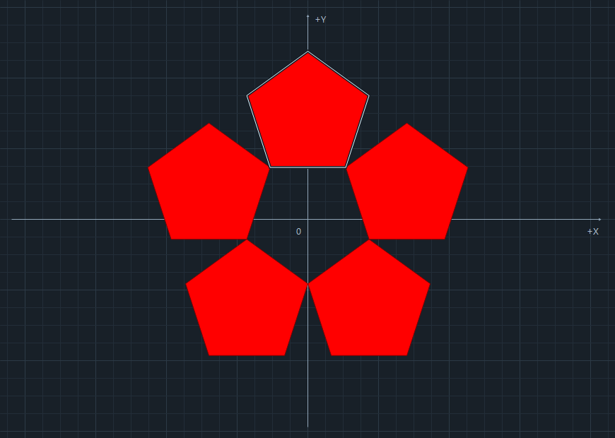
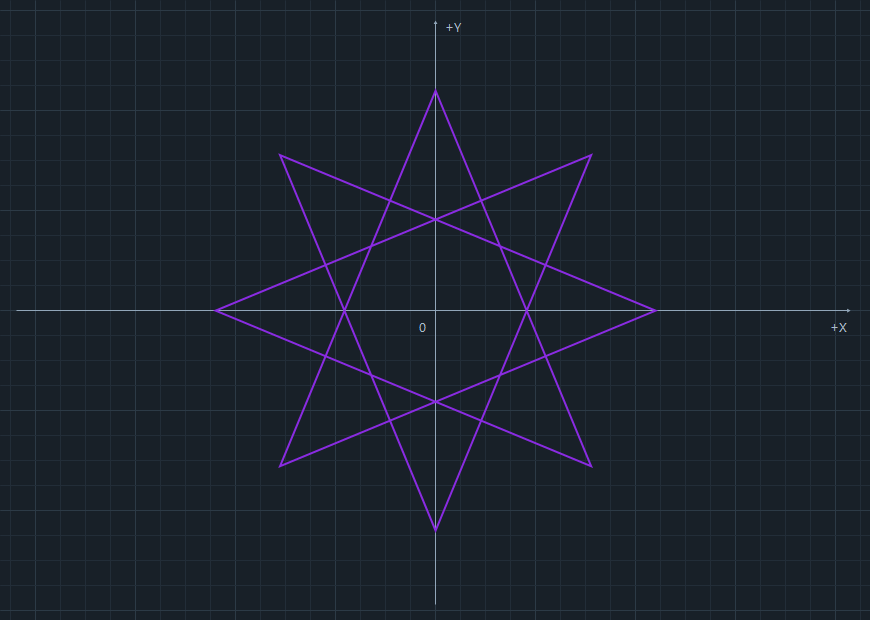
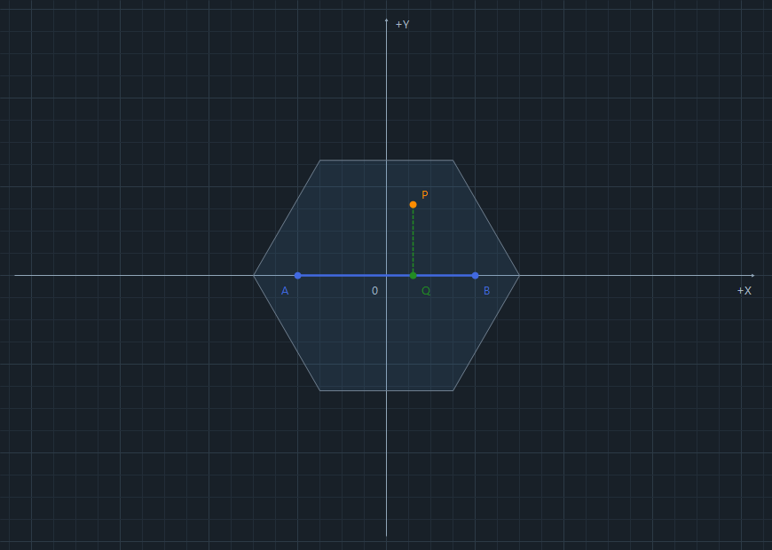

# GeoLab2D
## Informe técnico de computación gráfica bidimensional

Unidad 1. Fundamentos matemáticos, construcción algorítmica y programación orientada a objetos.

Fecha de preparación: 24 de octubre de 2026.

### Resumen

GeoLab2D permite construir, transformar y analizar figuras geométricas bidimensionales en una aplicación de escritorio. Su propósito es sustituir cálculos manuales repetitivos por operaciones matemáticas verificables y una representación interactiva. Se desarrolló en C# con Windows Forms y .NET Framework 4.7.2.

La aplicación genera un hexágono de seis colores, una margarita de cinco pentágonos y polígonos estrellados configurables. Incluye operaciones vectoriales, análisis de puntos y polígonos, proyección sobre segmentos y transformaciones mediante matrices homogéneas. El lienzo tiene un mínimo de 800 × 600 píxeles y puede crecer según el espacio disponible.

### Correspondencia con la evaluación

| Criterio de la asignación | Evidencia implementada | Puntos previstos en la rúbrica |
| --- | --- | --- |
| Construcción de tres figuras | Clases geométricas con ciclos, trigonometría y recorridos por índices | 30 |
| Operaciones vectoriales y geométricas | Magnitudes, direcciones, producto punto, determinante, áreas, perímetros, orientación, pertenencia y proyección | 25 |
| Transformaciones matriciales | Matrices 3 × 3 y composición T · R · S | 20 |
| Interfaz e interactividad | Edición numérica, colores, arrastre, selección por clic y coordenadas del cursor | 15 |
| Documentación y pruebas | Informe, pruebas automatizadas, evidencias y guion de demostración | 10 |

La tabla identifica la cobertura de los criterios; la calificación corresponde al docente. La grabación del video se realiza a partir del guion entregado y no forma parte de las evidencias automatizadas.

---

## 1 Diseño orientado a objetos

La solución separa las operaciones matemáticas, la presentación visual y la coordinación de la interfaz. Las clases matemáticas utilizan valores numéricos y PointF, sin depender de controles de Windows Forms ni de Graphics.

| Responsabilidad | Clases principales | Función |
| --- | --- | --- |
| Construcción y cálculo | HexagonoRegular, FlorMargarita, PoligonoEstrellado | Generan vértices y propiedades a partir de parámetros |
| Matemática reutilizable | Vector2D, Matriz3x3, GeometriaPlana | Operaciones vectoriales, transformaciones y algoritmos geométricos |
| Graficación | LienzoGeometrico | Dibuja con Graphics, Pen, Brush y PointF; gestiona selección y arrastre |
| Interfaz | GeoLab2D y paneles especializados | Reciben datos, solicitan cálculos y presentan resultados |
| Apariencia | PaletaFiguras, TemaOscuro y controles personalizados | Colores, tipografía, validación visual y distribución |

### Aplicación de POO

La encapsulación mantiene los parámetros y los arreglos internos protegidos. Las figuras exponen operaciones como ObtenerVertices u ObtenerPetalos; los resultados se devuelven en arreglos nuevos. Vector2D y Matriz3x3 ofrecen objetos inmutables desde el punto de vista del consumidor. Una edición de PaletaFiguras crea otra instancia, por lo que una validación fallida no deja cambios parciales.

La herencia permite especializar controles de Windows Forms: EntradaNumericaValidada deriva de NumericUpDown, BotonRedondeado de Button y los paneles de UserControl, directamente o mediante PanelContenidoAjustable. La coordinación utiliza eventos para comunicar cambios de parámetros y acciones sobre el lienzo.

### Flujo de actualización

```text
Entrada o arrastre del usuario
  -> validación de parámetros
  -> construcción de los vértices base
  -> composición y aplicación de la matriz
  -> cálculo de medidas y clasificación de puntos
  -> actualización de resultados y repintado del lienzo
```

El dibujo se realiza durante OnPaint y se solicita mediante Invalidate. Las plumas, pinceles y rutas temporales se liberan con using. El doble búfer reduce el parpadeo. Las figuras se recalculan desde su geometría base para evitar acumular errores al editar transformaciones.

---

## 2 Hexágono y margarita

### Hexágono regular de seis colores

En un hexágono regular el radio circunscrito coincide con el lado L. Los seis vértices se calculan mediante un ciclo:

```text
theta_i = i*pi/3,  i = 0,...,5
V_i = (L*cos(theta_i), L*sen(theta_i))
Perimetro = 6*L
Area = (3*sqrt(3)/2)*L^2
```

Cada sector se construye con el origen, V_i y V_((i+1) mod 6). Sus tres lados miden L y su ángulo central es 60 grados: son seis triángulos equiláteros. Se asignan seis colores diferentes, conservando esa condición cuando se edita la paleta. Para L = 10, el perímetro es 60 y el área es aproximadamente 259.807621 píxeles cuadrados.

### Margarita de cinco pentágonos

Se utiliza la disposición de la figura 1.2.1 del material de la Unidad 1: cinco pentágonos inscritos en un pentágono mayor y un hueco pentagonal central. El parámetro L es el lado del pentágono exterior, no el lado de cada pétalo.

```text
phi = (1 + sqrt(5))/2
s = L/phi^2
r = s/(2*sen(pi/5));  a = r*cos(pi/5)
theta_i = pi/2 + i*2*pi/5,  i = 0,...,4
C_i = 2*a*(cos(theta_i), sen(theta_i))
V_ij = C_i + r*(cos(theta_i+j*2*pi/5), sen(theta_i+j*2*pi/5))
```

Los centros están separados por 72 grados. Los interiores de los pétalos no se superponen; los vecinos se tocan en un vértice. La relación 2a + r = phi²r justifica la inscripción en el pentágono exterior. El área de un pétalo es 5s²/(4 tan(pi/5)) y el área total es cinco veces ese valor. El hueco central queda excluido.

 

---

## 3 Polígonos estrellados

Se generan N vértices de un polígono regular de radio R y se conectan con salto K. Esta construcción utiliza diagonales y permite una estrella o una composición de varias figuras entrelazadas.

```text
theta_i = pi/2 + i*2*pi/N
V_i = (R*cos(theta_i), R*sen(theta_i))
siguiente = (indice + K) mod N
d = MCD(N,K)
vertices por recorrido = N/d
longitud total = 2*N*R*sen(pi*K/N)
```

Los recorridos comienzan en los índices 0 a d-1. Cada uno se cierra conectando su último vértice con el primero. El máximo común divisor permite cubrir todos los vértices sin unir artificialmente recorridos independientes. La generación de puntos y recorridos es lineal respecto de N.

| N | K | Recorridos | Interpretación |
| --- | --- | --- | --- |
| 5 | 2 | 1 | Pentagrama |
| 6 | 2 | 2 | Dos triángulos |
| 8 | 3 | 1 | Estrella de ocho puntas |
| 10 | 4 | 2 | Dos pentagramas |
| 16 | 6 | 2 | Dos estrellas de ocho puntas |

La interfaz admite de 5 a 64 puntas y saltos desde 2 hasta floor((N-1)/2). Se excluyen K = 1, que dibuja el polígono convexo, y K = N/2, que produciría recorridos degenerados de dos vértices. El modelo admite hasta 128 puntas como validación interna configurable.

La longitud mostrada suma todos los segmentos. En el análisis, el área algebraica incluye multiplicidades y posibles cancelaciones; no equivale necesariamente al área del relleno visible. Para la pertenencia y el relleno del análisis se utiliza la regla par-impar, indicada en la interfaz.



---

## 4 Vectores y geometría de polígonos

### Operaciones vectoriales

Para A = (ax, ay) y B = (bx, by):

```text
|A| = sqrt(ax^2 + ay^2)
direccion(A) = atan2(ay,ax)*180/pi
A punto B = ax*bx + ay*by
det(A,B) = ax*by - ay*bx
```

La dirección se normaliza al intervalo [0,360) grados. El vector cero tiene magnitud cero y dirección no definida; el modelo devuelve un valor anulable y la interfaz explica ese caso. El producto punto es cero para vectores no nulos perpendiculares. El valor absoluto del determinante corresponde al área del paralelogramo y su signo expresa orientación cartesiana.

### Área y perímetro

Para un contorno ordenado, cerrando el último vértice con el primero, se usa la fórmula del cordón:

```text
Area firmada = (1/2)*sum(x_i*y_(i+1) - x_(i+1)*y_i)
Perimetro = sum(distancia(V_i,V_(i+1)))
```

La implementación usa una suma equivalente de determinantes respecto del primer vértice para reducir cancelación numérica. En polígonos simples, el valor absoluto del área firmada es su área geométrica. En la margarita se suman los pétalos y la longitud de sus cinco contornos incluye los lados que rodean el hueco.

### Orientación y pertenencia

Se calcula D = (Bx-Ax)(Py-Ay) - (By-Ay)(Px-Ax). Un D positivo indica orientación antihoraria; uno negativo, horaria. Se considera colineal cuando |D| no supera epsilon por la longitud de AB, con epsilon = 0.00001 unidades. Si A = B, la interfaz indica que no se determina una dirección.

Para clasificar P se verifica primero su distancia a los bordes. Si está dentro de la tolerancia, se devuelve Borde. En otro caso, un rayo horizontal cuenta cruces: una cantidad impar indica Dentro y una cantidad par, Fuera. La comparación semiabierta en Y evita contar dos veces un vértice. El algoritmo recorre los bordes en tiempo lineal. La paridad se acumula sobre todos los contornos y permite huecos.

---

## 5 Proyección sobre segmentos y matrices

### Punto más cercano

La proyección de P sobre el segmento AB usa el producto punto y un parámetro limitado:

```text
v = B - A
t0 = ((P-A) punto v)/(v punto v)
t = max(0,min(1,t0))
Q = A + t*v
distancia minima = |P-Q|
```

El límite es esencial: t = 0 corresponde a A y t = 1 a B. Sin esa limitación se proyectaría sobre toda la recta. Si A = B se devuelve Q = A y t = 0 por convenio, evitando una división por cero. Por ejemplo, A=(0,0), B=(10,0), P=(3,4) produce Q=(3,0), t=0.3 y distancia 4.

### Matrices homogéneas

Se emplean vectores columna (x,y,1) y matrices 3 × 3 calculadas en el proyecto:

```text
T = [1 0 Tx]    R = [cos -sen 0]    S = [Sx 0  0]
    [0 1 Ty]        [sen  cos 0]        [0  Sy 0]
    [0 0 1 ]        [0    0  1]        [0  0  1]

M = T*R*S
p' = M*p
```

El orden es escalar, rotar alrededor del origen y trasladar. La multiplicación implementa C[i,j] = sum(A[i,k]B[k,j]); Graphics no realiza estos cálculos. Para p=(1,2), escala=(2,3), ángulo=90 grados y traslación=(5,-1), los pasos producen (2,6), (-6,2) y finalmente (-1,1).

Traslación y rotación conservan área y perímetro. La escala multiplica el área por |Sx*Sy|. Con escala uniforme k, las longitudes se multiplican por |k|; con escala no uniforme se recalcula cada segmento. El análisis usa los contornos transformados y conserva A, B y P en las coordenadas del lienzo.

---

## 6 Interfaz y validaciones

La interfaz oscura organiza geometría, colores, transformaciones y resultados en secciones plegables. Los resultados se separan por tema. El botón superior Cómo interactuar abre una guía temporal, liberando espacio en la barra lateral.

El usuario puede arrastrar figuras, extremos de vectores y puntos A, B y P. Un clic selecciona un sector o pétalo, sincroniza el desplegable de colores y lo resalta. Se utiliza el umbral de arrastre del sistema para diferenciar ambas acciones. Los puntos tienen prioridad cuando se superponen a una figura. Las coordenadas del cursor se muestran al pie y se limpian al salir del lienzo.

```text
x_modelo = x_raton - ancho_lienzo/2
y_modelo = alto_lienzo/2 - y_raton
```

El origen está en el centro y Y positivo apunta hacia arriba. No se introduce zoom; una unidad equivale a un píxel del lienzo. La cuadrícula y los ejes pueden ocultarse. El tamaño base y el tamaño transformado se distinguen en la presentación de resultados.

| Parámetro | Rango de interfaz | Validación |
| --- | --- | --- |
| Lado o radio | 1 a 280 px | Un decimal |
| Puntas y salto | 5 a 64; salto hasta floor((N-1)/2) | Enteros y ajuste dinámico |
| Vectores y puntos | -250 a 250 px | Dos decimales |
| Traslación | -250 a 250 px | Dos decimales |
| Ángulo | -360 a 360 grados | Dos decimales |
| Escalas | 0.10 a 3.00 | Dos decimales |
| Colores del hexágono | Seis distintos | Colores opacos y sin duplicados |

Los rangos de interfaz son decisiones de uso, independientes de los límites matemáticos. La entrada numérica inválida recupera el último valor válido y muestra un aviso. Las clases matemáticas rechazan parámetros no finitos y argumentos incompatibles. El vector cero, el segmento degenerado y los puntos sobre bordes tienen tratamiento explícito. Se informa si una transformación deja parte de la figura fuera del lienzo.



---

## 7 Método de validación

La solución incluye un proyecto de consola de pruebas sin paquetes externos. Un fallo produce código de salida 1 y detiene la validación. Solo después de superar los grupos se exportan los casos de referencia y se registra el resultado final. La compilación se realiza en configuración Release.

| Grupo | Comprobaciones principales |
| --- | --- |
| Hexágono | Seis lados y radios iguales, simetría, área por vértices y fórmula analítica |
| Margarita | Regularidad, simetría de 72 grados, inscripción, hueco y área de cinco pétalos |
| Estrellas | Todas las combinaciones admitidas de N y K hasta 64 puntas, con radios 1, 150.5 y 280 |
| Vectores | Magnitud, cuadrantes, perpendicularidad, paralelismo, determinante y vector cero |
| Geometría | Polígonos convexos, cóncavos y cruzados, huecos, bordes y proyecciones limitadas |
| Matrices | Identidad, composición, no conmutatividad, inversa de rotación y medidas transformadas |
| Interacción | Paletas, texto inválido, arrastre, selección transformada y coordenadas del cursor |

La exploración de estrellas comprende 2790 combinaciones de parámetros, cada una con verificaciones de cierre, cobertura de vértices, simetría, radios y longitudes. No representa el número total de aserciones del proyecto. Además se exportan 16 casos numéricos conocidos con esperado, obtenido, tolerancia y resultado.

### Precisión y tolerancias

Los cálculos se realizan principalmente en double y los vértices de dibujo se expresan mediante PointF. Las comparaciones admiten redondeo: 0.0001 en posiciones y longitudes individuales, 0.001 en algunos perímetros y matrices, y hasta 0.05 en sumas de áreas construidas con PointF. Los 16 casos exportados utilizan tolerancia 0.000001. La tolerancia geométrica de borde es independiente de la tolerancia de las pruebas.

### Evidencias y alcance

Los archivos compilacion-release.txt, pruebas-release.txt, validacion.json y casos-referencia.csv acompañan el informe en entrega/evidencias. Las ilustraciones de este documento son renderizados del lienzo generados por las pruebas, no capturas certificadas de toda la interfaz. La revisión de diálogos nativos, foco, redimensionamiento y diseñador se conserva como lista manual en los documentos de cada etapa.

---

## 8 Resultados numéricos de referencia

La tabla se genera a partir del CSV producido por la ejecución aprobada de las pruebas. Los valores se redondean a seis decimales solo para presentarlos; la comparación utiliza los valores completos del archivo. Tolerancia de cada fila: 0.000001.

<!-- INICIO_CASOS -->
| Caso | Esperado | Obtenido | Resultado |
| --- | --- | --- | --- |
| Hexagono L10 perimetro | 60.000000 | 60.000000 | APROBADO |
| Hexagono L10 area | 259.807621 | 259.807621 | APROBADO |
| Margarita L10 lado petalo | 3.819660 | 3.819660 | APROBADO |
| Margarita L10 area total | 125.507135 | 125.507135 | APROBADO |
| Estrella N5 K2 R10 longitud | 95.105652 | 95.105652 | APROBADO |
| Estrella N10 K4 componentes | 2.000000 | 2.000000 | APROBADO |
| Vector A3 4 magnitud | 5.000000 | 5.000000 | APROBADO |
| Vector A3 4 direccion | 53.130102 | 53.130102 | APROBADO |
| Producto punto perpendiculares | 0.000000 | 0.000000 | APROBADO |
| Determinante A3 4 B-4 3 | 25.000000 | 25.000000 | APROBADO |
| Proyeccion Qx | 3.000000 | 3.000000 | APROBADO |
| Proyeccion Qy | 0.000000 | 0.000000 | APROBADO |
| Proyeccion distancia | 4.000000 | 4.000000 | APROBADO |
| Proyeccion parametro | 0.300000 | 0.300000 | APROBADO |
| Composicion TRS x | -1.000000 | -1.000000 | APROBADO |
| Composicion TRS y | 1.000000 | 1.000000 | APROBADO |
<!-- FIN_CASOS -->

### Conclusiones

Las tres figuras se construyen a partir de parámetros y fórmulas, sin listas de coordenadas precalculadas. La separación POO permite verificar las operaciones matemáticas y reutilizarlas sin depender de la interfaz. Las matrices homogéneas relacionan construcción, transformación y análisis, mientras que la interacción facilita contrastar resultados con el dibujo.

Las estrellas requieren interpretar por separado longitud de trazos, área algebraica y pertenencia par-impar. Esa distinción evita asignar al relleno visible un área que corresponde a otra definición matemática. Los colores se conservan durante la sesión; no se implementa persistencia de diseños entre ejecuciones.

### Referencias

Villacís, C., Zambrano, M., Cuichán, E., y Sanipatín, K. (s. f.). Computación Gráfica en C#. Capítulo 1: Conceptos elementales [Material de curso en PDF]. Se consultaron los fundamentos de coordenadas y GDI+, la margarita de las páginas 83 a 88 y los ejemplos de polígonos estrellados desde la página 97.

Código fuente de GeoLab2D y documentos de las etapas 2 a 8 incluidos en el repositorio. Las validaciones y cifras de ejecución corresponden a los archivos de evidencia que acompañan esta entrega.
