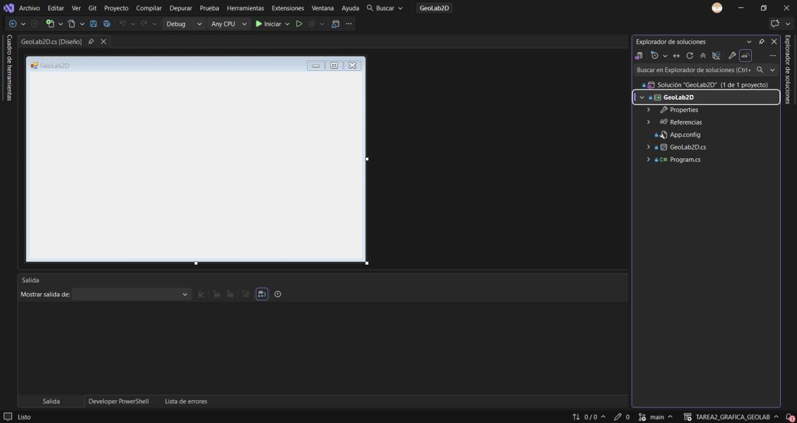
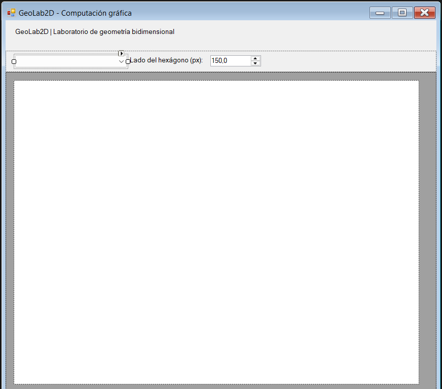
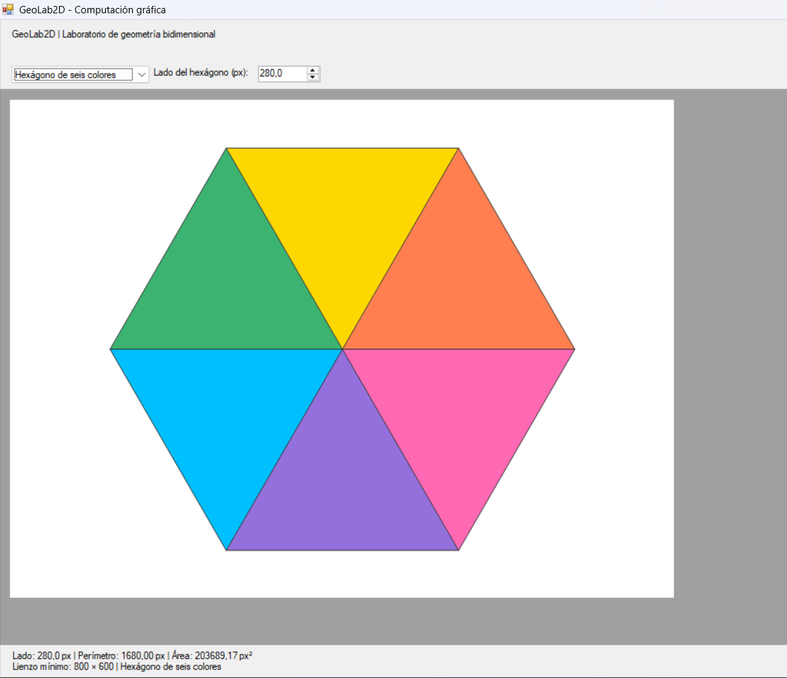
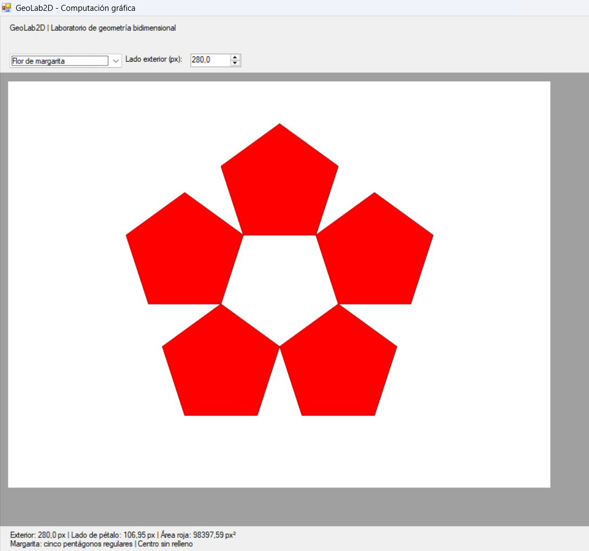
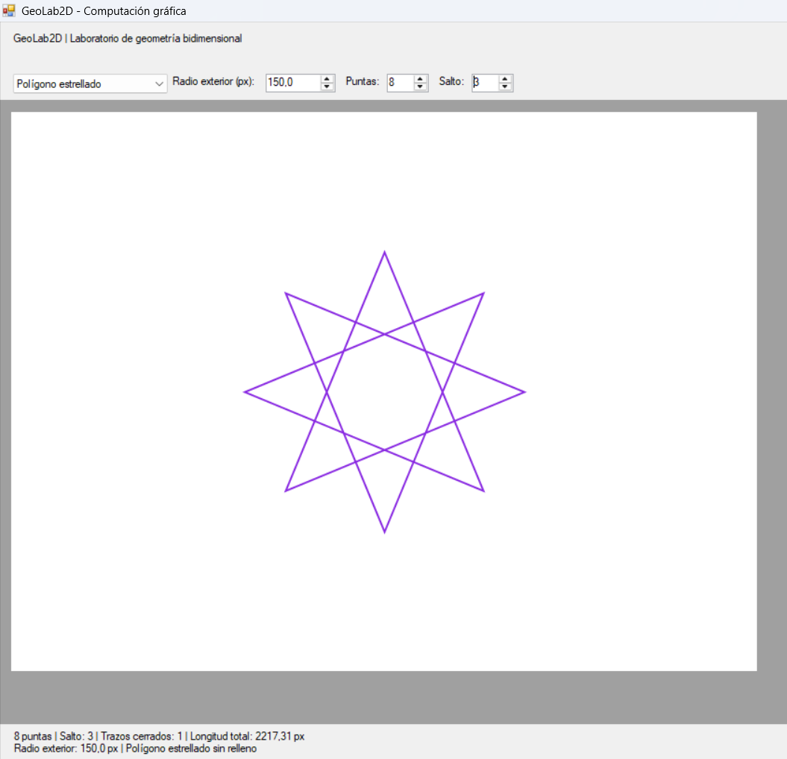
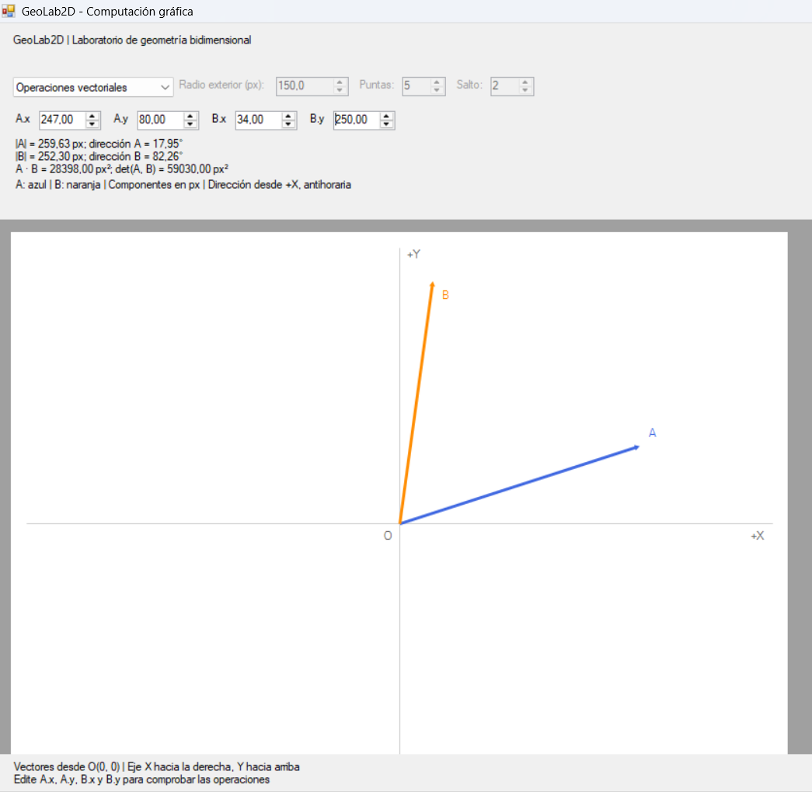
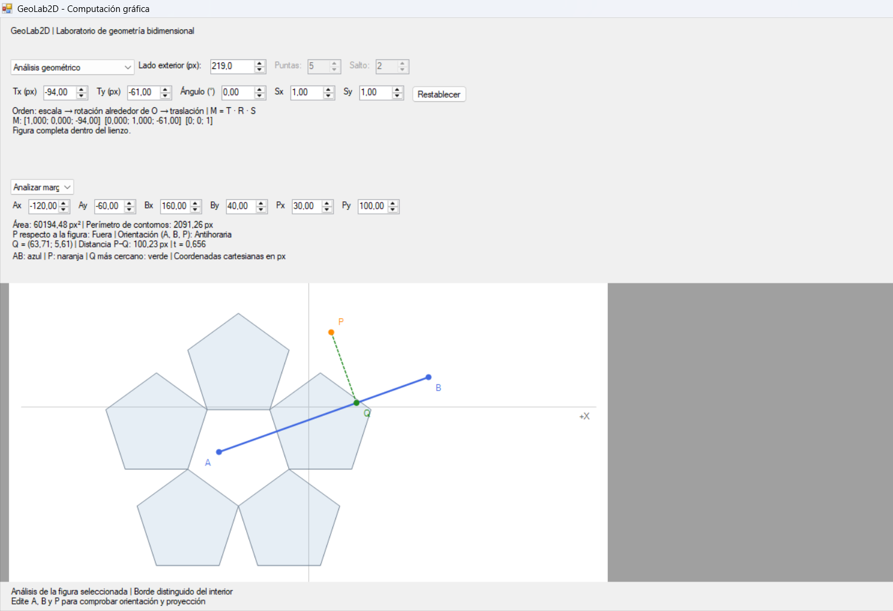

# Desarrollo paso a paso

Capturas proporcionadas por el estudiante. Corresponden a las etapas anteriores al rediseño de la interfaz.

## Paso 1 Creación del proyecto

Se crea la solución en Visual Studio con la plantilla de Windows Forms para C# y .NET Framework. La captura muestra el formulario inicial y la estructura del proyecto antes de incorporar las figuras. Este es el punto de partida de la aplicación.

## Paso 2 Preparación del lienzo y los parámetros

Se incorpora una superficie de dibujo, el selector de figura y el control de lado. Esta versión inicial prepara la entrada de parámetros y el espacio donde se representarán las construcciones. La interfaz de esta captura todavía utiliza el diseño claro anterior al panel lateral.

## Paso 3 Construcción del hexágono de seis colores

Se generan los seis vértices con seno y coseno y se conectan con el centro para formar seis triángulos equiláteros. La captura muestra un lado de 280 píxeles, perímetro de 1680 píxeles y área aproximada de 203689.17 píxeles cuadrados. El control del lado permite comprobar que el dibujo y sus medidas se actualizan juntos.

## Paso 4 Construcción de la margarita

Se añaden cinco pentágonos regulares distribuidos simétricamente, conservando el hueco central. El parámetro representa el lado del pentágono exterior y de él se obtiene el lado de cada pétalo. La captura corresponde a una dimensión exterior de 280 píxeles y a la versión con cinco pétalos rojos.

## Paso 5 Construcción de polígonos estrellados

Se incorpora el recorrido de vértices por saltos. En esta evidencia se utilizan ocho puntas, salto tres y radio exterior de 150 píxeles. El recorrido se cierra sin coordenadas fijas y su longitud total es aproximadamente 2217.31 píxeles. La versión final mantiene esta construcción y amplía el máximo de la interfaz a 64 puntas.

## Paso 6 Operaciones vectoriales

Se añade la entrada de componentes para dos vectores y su representación mediante flechas desde el origen. El panel presenta magnitudes, direcciones, producto punto y determinante. Esta etapa permite contrastar los valores numéricos con la dirección y la longitud de los vectores dibujados.

## Paso 7 Análisis geométrico y proyección

Se integran los puntos A, B y P, el segmento AB y su punto Q más cercano a P. La evidencia muestra el análisis sobre la margarita, junto con los controles de transformación y la matriz. Posteriormente se reorganizó esta información en secciones del panel lateral y se añadió arrastre, selección por clic y ayuda contextual.

